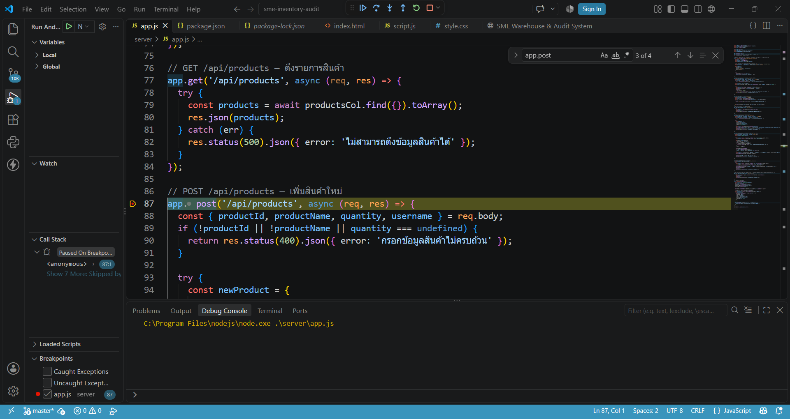
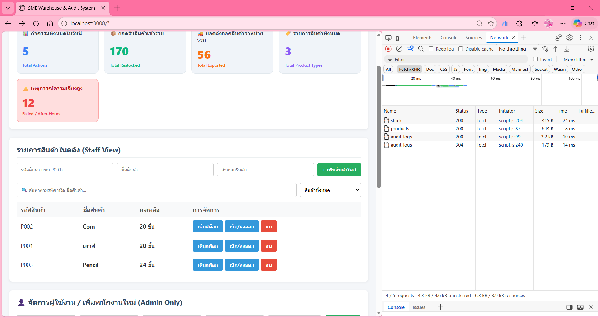

```
# SME Warehouse Management & Audit Trail System

เว็บแอปพลิเคชันจัดการคลังสินค้าสำหรับ SME ที่มีระบบบันทึกประวัติการทำงาน (Audit Trail) และตรวจจับการใช้งานนอกเวลาทำการ (After-Hours Rule: 08:30 - 17:30 น.) แบบอัตโนมัติ

---

## 📁 โครงสร้างโปรเจกต์ (Directory Structure)

```text
sme-inventory-audit/
├── server/
│   ├── app.js          # Backend Express 
│   ├── package.json    # Project Dependencies
│   └── .gitignore
├── public/
│   ├── index.html      # Main Web Page Structure
│   ├── style.css       # UI Styling
│   └── script.js       # Frontend Fetch API Logic
├── screenshots/
│   ├── vscode-debug.png      # VS Code 
│   ├── admin1                # Website
│   ├── admin2                # Website
│   ├── member1               # Website
│   └── devtools-network.png  # Chrome DevTools 
├── README.md
└── .gitignore

```

---

## 🛠️ วิธีติดตั้งและเรียกใช้งาน (Setup & Installation)

### 1. การเตรียมระบบ

* ตรวจสอบให้แน่ใจว่าเปิดใช้งาน **MongoDB Server** เรียบร้อยแล้ว (ที่ `mongodb://127.0.0.1:27017`)


### 2. การติดตั้ง Dependencies

เปิด Terminal และไปยังโฟลเดอร์ `server` จากนั้นสั่งติดตั้งแพ็กเกจ:

```bash
cd server
npm install

```

### 3. การรันเซิร์ฟเวอร์

สั่งรันเซิร์ฟเวอร์ด้วยคำสั่ง:

```bash
npm run dev
# หรือ npm start

```

เปิดเบราว์เซอร์แล้วเข้าใช้งานที่ URL: [http://localhost:3000](http://localhost:3000)

---

## 🔌 รายการ REST API Endpoints

| HTTP Method | Endpoint | คำอธิบาย |
| --- | --- | --- |
| **GET** | `/api/products` | ดึงรายการสินค้าทั้งหมดในคลัง|
| **POST** | `/api/products` | เพิ่มรายการสินค้าใหม่ลงในคลัง (CREATE)|
| **POST** | `/api/products/:id/stock` | ปรับเพิ่ม/ลด จำนวนสินค้าคงเหลือ (RESTOCK / EXPORT)|
| **DELETE** | `/api/products/:id` | ลบสินค้าออกจากคลัง (DELETE)|
| **GET** | `/api/audit-logs` | ดึงประวัติกิจกรรมผู้ใช้งานและบันทึกความปลอดภัยทั้งหมด|

---

## 📸 หลักฐานการดีบัก (Debug Screenshots)

### 1. VS Code Server-side Debugging (Breakpoint)

แสดงการตั้งจุด Breakpoint (จุดสีแดง) ในไฟล์ `server/app.js` และตรวจสอบค่าตัวแปรขณะเซิร์ฟเวอร์ทำงาน


### 2. Browser DevTools Network Tab

แสดงการส่ง Fetch API Request และรับ Status Code (200 / 201) ในแท็บ Network ของ Chrome DevTools
